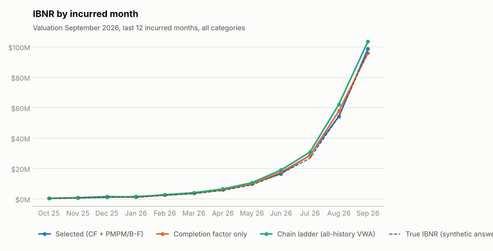
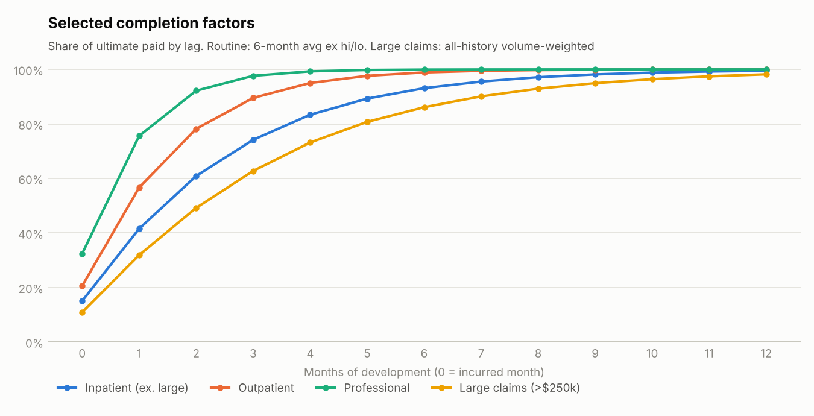
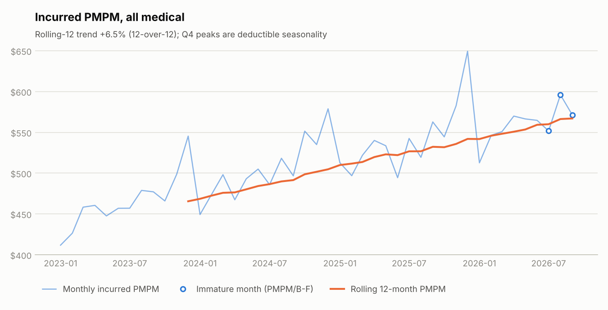
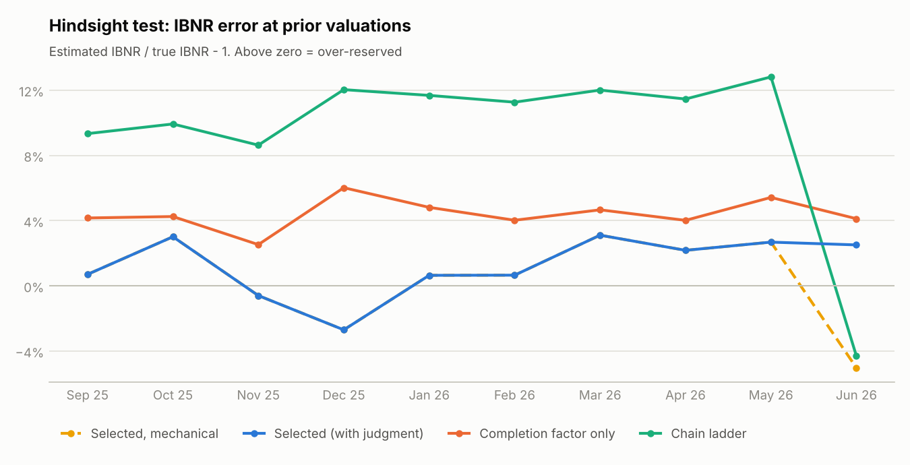

# Medical IBNR Reserve Report: September 2026 Valuation

*Paid claims through 09/30/2026; incurred months 2023-01 to 2026-09. Commercial medical (inpatient, outpatient, professional). Synthetic data; illustrative only.*

## 1. Summary

* **Recommended IBNR liability: $249.3M**. That is $226.2M best-estimate IBNR, plus a 7.5% margin ($17.0M) and 2.5% claim adjustment expense ($6.1M).
* The best estimate is 1.83 months of current incurred claims. For incurred months open at the prior close, IBNR developed **-0.1M** (-0.1% of prior IBNR) in September.
* Year-to-date incurred PMPM is **$558.95**, +6.5% over the same months of 2025. Rolling-12 trend is +6.5%.
* Large claimants over $250k are reserved separately: $43.6M of IBNR (19% of the total) on a pooled, trended large-claim PMPM.
* Actuarial selections (section 3) change IBNR by +0.9M from the mechanical result of $225.4M.
* The chain ladder (all-history volume-weighted) is +8.5% above the selected IBNR. Recent link ratios are lower than older ones because claims are paying faster, so all-history factors overstate the remaining runout. The Mack 75th–95th percentile range on the chain ladder is $245.6M to $250.9M.

### Reserve summary by category

| Category | Paid to date | IBNR: completion factor | IBNR: chain ladder | **IBNR: selected** | Margin | CAE | **Total liability** |
|---|---|---|---|---|---|---|---|
| Inpatient (ex. large) | $922.9M | $67.3M | $73.1M | $65.1M | $4.9M | $1.8M | $71.8M |
| Outpatient | $1,494.3M | $71.0M | $77.2M | $71.9M | $5.4M | $1.9M | $79.2M |
| Professional | $1,655.6M | $46.0M | $52.1M | $45.7M | $3.4M | $1.2M | $50.3M |
| Large claims (>$250k) | $406.6M | $43.4M | $43.1M | $43.6M | $3.3M | $1.2M | $48.0M |
| Total | $4,479.5M | $227.6M | $245.5M | $226.2M | $17.0M | $6.1M | $249.3M |

## 2. Methodology

* **Completion factor method** (months aged 3+). Link ratios are the straight average of the latest 6 incurred months at each lag, excluding the high and low. Ultimate = paid ÷ completion factor. Lags of 36+ are treated as complete.
* **PMPM / Bornhuetter-Ferguson** (the latest 3 incurred months). Completion is too low for paid ÷ CF to be credible. The expected cost is the trended, seasonally adjusted PMPM times member months. Ultimate = paid + (1 − CF) × expected, so emerging paid claims carry weight in proportion to completion.
* **Large claims** (claimants over $250k). They are removed from the inpatient triangle and reserved by B-F for every incurred month, on a pooled large-claim PMPM. The pool is the latest 24 months aged 6+, trended at 9% a year. Large-claim link ratios are volume-weighted over all history because the data is thin. One $2M claimant can move a month's paid ÷ CF estimate by more than the routine IBNR on it.
* **Chain ladder.** Volume-weighted link ratios over all history with no judgment applied. It serves as a benchmark and as the basis for the Mack (1993) standard error.
* **PMPM trend.** A log-linear regression with calendar-month seasonality, fitted on the latest 30 credible months. The base period is the latest 12 credible months, deseasonalised and centred at their midpoint.

### Completion factors by lag

| Lag | Inpatient (ex. large) | Outpatient | Professional | Large claims (>$250k) |
|---|---|---|---|---|
| 0 | 15.1% | 20.6% | 32.4% | 10.9% |
| 1 | 41.6% | 56.7% | 75.6% | 31.9% |
| 2 | 60.9% | 78.2% | 92.2% | 49.2% |
| 3 | 74.2% | 89.6% | 97.7% | 62.8% |
| 4 | 83.4% | 95.0% | 99.3% | 73.2% |
| 5 | 89.3% | 97.7% | 99.8% | 80.8% |
| 6 | 93.1% | 98.9% | 99.9% | 86.2% |
| 7 | 95.5% | 99.5% | 100.0% | 90.1% |
| 8 | 97.2% | 99.8% | 100.0% | 93.0% |

### Latest months by incurred month (all categories)

| Incurred | Method | Member months | Paid | Completion | PMPM expected | Selected ultimate | Selected IBNR | PMPM | True ultimate* |
|---|---|---|---|---|---|---|---|---|---|
| 2026-04 | CF | 219,206 | $118.6M | 94.9% | $123.9M | $124.9M | $6.3M | $569.90 | $124.2M |
| 2026-05 | CF | 219,383 | $114.2M | 91.9% | $124.1M | $124.3M | $10.1M | $566.43 | $123.5M |
| 2026-06 | CF | 219,891 | $107.6M | 86.6% | $123.3M | $124.2M | $16.6M | $564.66 | $124.2M |
| 2026-07 | PMPM/B-F | 220,771 | $93.1M | 76.4% | $122.2M | $121.8M | $28.7M | $551.73 | $119.8M |
| 2026-08 | PMPM/B-F | 221,871 | $77.8M | 58.9% | $129.1M | $132.2M | $54.4M | $595.98 | $132.1M |
| 2026-09 | PMPM/B-F | 222,253 | $28.3M | 22.3% | $127.5M | $127.0M | $98.7M | $571.40 | $125.6M |

\* True ultimate comes from the synthetic answer key and is shown for validation only. A real valuation never has it.

## 3. Actuarial selections

These are departures from the mechanical method, each logged with its rationale in `selections.json`. A selection applies only to closes on or after the month it references, so the hindsight test uses what was knowable at each close.

| # | Selection | Rationale |
|---|---|---|
| 1 | Exclude paid month 2026-06 from link-ratio averages | Claims operations reported a processing slowdown in June 2026 (claims system migration). The paid-month diagnostic shows June payments at 87% of expected. Link ratios on this diagonal understate development and are excluded from the averages. |
| 2 | Exclude paid month 2026-07 from link-ratio averages | Catch-up of the June backlog: July payments ran 128% of expected. Link ratios on this diagonal overstate development and are excluded from the averages. |
| 3 | Restate paid for pended backlog at the 2026-06 close | At the June 2026 close, paid-to-date on every open month is short by the delayed payments. Claims operations' pended-inventory report gives the excess pended dollars by category. Paid is grossed up by paid / (paid + excess pended) before completion factors are applied, so the backlog is reserved for rather than read as lower cost. |

Impact at the September 2026 close:

| Category | IBNR: mechanical | IBNR: with judgment | Impact | Impact % |
|---|---|---|---|---|
| Inpatient (ex. large) | $64.9M | $65.1M | +0.22M | +0.3% |
| Outpatient | $71.6M | $71.9M | +0.29M | +0.4% |
| Professional | $45.4M | $45.7M | +0.24M | +0.5% |
| Large claims (>$250k) | $43.4M | $43.6M | +0.13M | +0.3% |
| Total | $225.4M | $226.2M | +0.88M | +0.4% |

The selections matter most at the June 2026 close. The mechanical method missed true IBNR by -5.0% there, and the method with judgment missed by +2.5% (section 6).

## 4. PMPM trend

| Assumption | Inpatient (ex. large) | Outpatient | Professional |
|---|---|---|---|
| Fitted annual trend | +4.8% | +9.0% | +4.9% |
| Selected annual trend | +4.8% | +9.0% | +4.9% |
| R² | 0.88 | 0.90 | 0.88 |
| Base PMPM (deseasonalised) | $115.71 @ 2026-01 | $188.81 @ 2026-01 | $196.79 @ 2026-01 |
| Q4 / Q1 seasonal ratio | 1.12 | 1.11 | 1.06 |

Large claims are trended at the selected 9% a year (frequency and severity combined).

Calendar-year incurred PMPM (partial years are not comparable to full years because of seasonality; use the YTD comparison above):

| Year | Months | Member months | Incurred | PMPM | Change |
|---|---|---|---|---|---|
| 2023 | 12 | 2,239,445 | $1,042.5M | $465.53 |  |
| 2024 | 12 | 2,377,723 | $1,200.0M | $504.70 | +8.4% |
| 2025 | 12 | 2,501,861 | $1,355.8M | $541.93 | +7.4% |
| 2026 | 9 | 1,981,011 | $1,107.3M | $558.95 | +3.1% |

## 5. Reserve roll-forward

From the August close to the September close.

| Category | Prior IBNR | Paid in month | Expected remaining | Current IBNR (prior months) | Development | % of prior | New month IBNR | Current IBNR |
|---|---|---|---|---|---|---|---|---|
| Inpatient (ex. large) | $65.1M | $22.6M | $42.5M | $43.0M | +0.5M | +0.8% | $22.2M | $65.1M |
| Outpatient | $72.0M | $33.5M | $38.5M | $37.0M | -1.6M | -2.2% | $34.9M | $71.9M |
| Professional | $45.9M | $30.9M | $15.0M | $15.8M | +0.8M | +1.7% | $29.9M | $45.7M |
| Large claims (>$250k) | $43.3M | $11.7M | $31.7M | $31.8M | +0.1M | +0.3% | $11.8M | $43.6M |
| Total | $226.3M | $98.6M | $127.7M | $127.5M | -0.1M | -0.1% | $98.7M | $226.2M |

Development = current IBNR on prior months − (prior IBNR − paid in month). Positive is adverse.

## 6. Hindsight test

Each prior valuation is re-run on the data as it stood at that month-end and compared with what is known now. Because the data is synthetic, the comparison is against **true** IBNR from the answer key.

| Valuation | Runout (mo) | **IBNR: selected** | IBNR: mechanical | IBNR: completion factor | IBNR: chain ladder | True IBNR* | Selected error | Mechanical error | CF error | CL error |
|---|---|---|---|---|---|---|---|---|---|---|
| 2025-09 | 12 | $205.6M | $205.6M | $212.7M | $223.2M | $204.2M | +0.7% | +0.7% | +4.2% | +9.3% |
| 2025-10 | 11 | $210.5M | $210.5M | $213.0M | $224.6M | $204.3M | +3.0% | +3.0% | +4.3% | +9.9% |
| 2025-11 | 10 | $210.8M | $210.8M | $217.4M | $230.4M | $212.1M | -0.6% | -0.6% | +2.5% | +8.6% |
| 2025-12 | 9 | $220.1M | $220.1M | $239.8M | $253.4M | $226.2M | -2.7% | -2.7% | +6.0% | +12.0% |
| 2026-01 | 8 | $215.2M | $215.2M | $224.2M | $238.8M | $213.8M | +0.7% | +0.7% | +4.8% | +11.7% |
| 2026-02 | 7 | $214.9M | $214.9M | $222.0M | $237.5M | $213.4M | +0.7% | +0.7% | +4.0% | +11.3% |
| 2026-03 | 6 | $219.3M | $219.3M | $222.6M | $238.2M | $212.6M | +3.1% | +3.1% | +4.7% | +12.0% |
| 2026-04 | 5 | $219.5M | $219.5M | $223.4M | $239.4M | $214.8M | +2.2% | +2.2% | +4.0% | +11.5% |
| 2026-05 | 4 | $221.0M | $221.0M | $226.9M | $242.9M | $215.3M | +2.7% | +2.7% | +5.4% | +12.8% |
| 2026-06 | 3 | $237.4M | $220.0M | $241.1M | $221.6M | $231.6M | +2.5% | -5.0% | +4.1% | -4.3% |

Selected-method error averaged +1.2% (mean absolute 1.9%). The mechanical version's mean absolute error was 2.1%. Completion factor only averaged +4.4%; chain ladder averaged +9.5%.

## 7. Paid-month diagnostic

Actual payments in each calendar month on incurred months already open, compared with the payments the selected link ratios expected (lags 1 to 12, routine claims; large claimants are too lumpy for this test). Months more than 5% off expected are flagged.

| Paid month | Actual paid | Expected paid | Actual / expected | Flag |
|---|---|---|---|---|
| 2025-10 | $77.5M | $75.3M | 1.030 |  |
| 2025-11 | $78.4M | $77.6M | 1.010 |  |
| 2025-12 | $82.4M | $78.5M | 1.049 |  |
| 2026-01 | $86.0M | $84.1M | 1.022 |  |
| 2026-02 | $82.2M | $82.7M | 0.993 |  |
| 2026-03 | $82.9M | $81.1M | 1.022 |  |
| 2026-04 | $82.5M | $82.0M | 1.006 |  |
| 2026-05 | $84.0M | $84.0M | 1.000 |  |
| 2026-06 | $74.3M | $85.0M | 0.873 | ⚠ |
| 2026-07 | $97.6M | $76.5M | 1.275 | ⚠ |
| 2026-08 | $83.0M | $83.4M | 0.995 |  |
| 2026-09 | $86.9M | $87.2M | 0.996 |  |

## 8. ASOP No. 43 disclosures

This section is organised along Actuarial Standard of Practice No. 43, *Unpaid Claim Estimates*.

**Intended purpose and measure.** The estimate is an unpaid claim estimate for medical claims incurred on or before September 30, 2026 and unpaid at that date, for monthly financial reporting. The measure is an actuarial central estimate ($226.2M), plus an explicit 7.5% margin for adverse deviation and 2.5% for claim adjustment expense. The recommended liability is $249.3M.

**Scope.** Commercial medical claims: inpatient (including large claimants), outpatient and professional. Excluded: pharmacy, capitation, provider incentive and risk-settlement accruals, premium deficiency reserves, and reinsurance or stop-loss recoveries.

**Methods and rationale.** Completion factors on recent averages for mature months follow current claims processing, which has sped up over the experience period. A PMPM-based Bornhuetter-Ferguson covers immature months where paid-to-date is not credible. Large claims are reserved separately on a pooled B-F so that a single claimant does not drive a month's estimate. The chain ladder and its Mack range are benchmarks; section 1 explains why they are not selected.

**Key assumptions.** 6-month average link ratios ex hi/lo; completion assumed at lag 36; PMPM/B-F for the latest 3 months; trend and seasonality from section 4; large-claim pool trend 9%; judgmental selections as listed in section 3.

**Data and reliance.** The data is a synthetic claims extract, membership file, large-claimant file and pended-inventory report. The estimate relies on these without audit, subject to the checks below (0 failures).

| Check | Result | Detail |
|---|---|---|
| Claims extract ties to triangles | Pass | extract $4,479,456,140 vs triangles $4,479,456,140 |
| No payment before incurral | Pass | 0 rows with paid month < incurred month |
| No negative paid cells | Pass | 0 negative incurred x paid cells |
| Membership for every incurred month | Pass | missing: none |
| Membership month-over-month change < 8% | Pass | largest change 3.7% |
| Large claims within inpatient totals | Pass | 905 claimants, $406,621,271 paid; 0 cells exceed inpatient |
| Large-claim file is claimant level | Pass | 905 unique claimants |

**Uncertainty.** Actual runout will differ from the estimate. The Mack standard error on the chain ladder is $5.3M (75th–95th percentile $245.6M–$250.9M). Over 10 prior closes, the selected method's mean absolute error against true IBNR was 1.9%. The main sources of uncertainty are: large-claim emergence, processing-speed changes, PMPM trend in the immature months, and seasonality in the latest quarter.

**Changes since the prior valuation.** Methods and assumptions are unchanged from the prior close. Judgmental selections are logged in section 3 with the date each took effect.

**Subsequent events.** None known.

*This is an illustrative portfolio analysis on synthetic data. It is not a Statement of Actuarial Opinion.*

## 9. Items for review

* **Paid-month anomaly: Jun 2026 (87% of expected), Jul 2026 (127% of expected).** A low month followed by a high one is a processing backlog and its catch-up, not a change in incurred cost. These diagonals are excluded from the link-ratio averages (section 3). Drop the exclusions once the diagonals roll out of the 6-month window.
* **Hindsight.** The largest selected-method miss was the March 2026 valuation (+3.1%).
* **Large claims.** The large-claim pool runs at $59.33 PMPM for September 2026. A run of $1M+ claimants would move it materially. Review the open large-claim list with case management before booking.
* **Margin.** IBNR plus margin and CAE ($249.3M) sits above the Mack chain ladder 75th percentile ($245.6M). Confirm the margin against the plan's historical IBNR runout before booking.

Supporting exhibits (triangles, link ratios, factors, Mack detail, data checks and assumptions) are in the Excel exhibits workbook. The live-formula model, where selections can be changed, is in the `ibnr_model` workbook.
